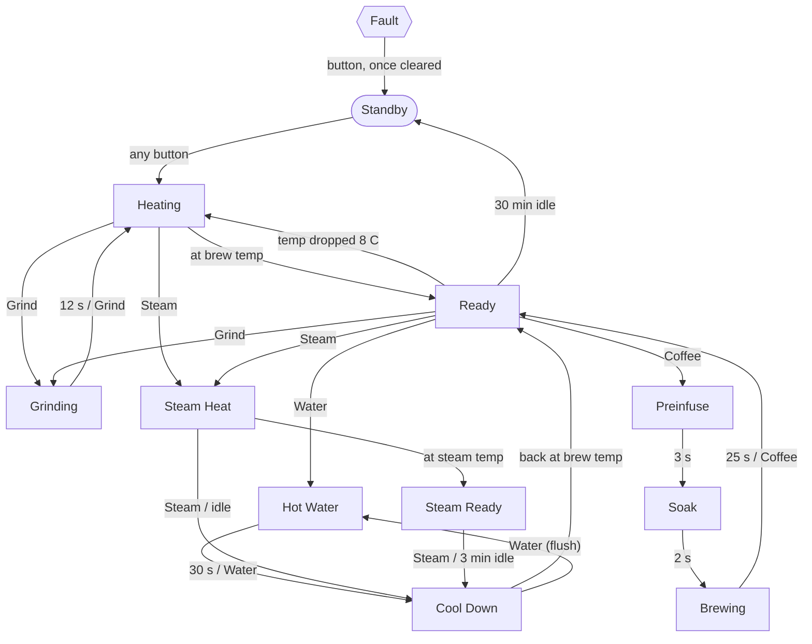

# PicoCoffeeZanussi

Replacement controller for a **Zanussi ZCOF637X** espresso machine, built on a Raspberry Pi **Pico 2 W**. The firmware is a single C++ file running a state machine. It handles heating, grinding, a three-stage brew (pre-infuse, soak, extract), hot water and steam, and it has safety cut-outs.

> [!WARNING]
> This project switches a mains-powered heater and pump. Build it only if you are competent with mains wiring. Use relays rated for the load, keep low-voltage and mains wiring separated, and keep the machine's original thermal fuses and thermostats in circuit. The firmware's safety checks are an extra layer, not a replacement for them.

## Features

- Brew sequence: pre-infuse, soak, extract, with a countdown on the display.
- Timed grinding for one dose.
- Hot water, and steam with its own higher temperature setting.
- Cool-down after steaming, so you can't brew with an overheated block.
- Heater control with hysteresis, driven by a K-type thermocouple.
- Safety faults that turn everything off and stay off until reset: thermocouple failure, over-temperature, and heating that takes too long.
- Automatic standby when the machine is left idle.
- 128x64 OLED status display.
- Serial log of every button press, state change and fault.

## Hardware

| Part | Notes |
|---|---|
| Raspberry Pi Pico 2 W (RP2350) | The original Pico (RP2040) also works if you change `PICO_BOARD` in `CMakeLists.txt` |
| MAX6675 module + K-type thermocouple | Mounted on the boiler/thermoblock |
| 1.3" SH1106 128x64 I2C OLED | A 0.96" SSD1306 also works, see [Configuration](#configuration) |
| 4-channel relay module, active-high | Heater, pump, group solenoid, grinder. Must be rated for mains loads |
| 4 momentary push buttons | Grind, Coffee, Water, Steam |
| Raspberry Pi Debug Probe (optional) | For flashing, debugging and the serial log |

## Wiring

All signals are 3.3 V. Physical pin numbers are for the Pico 2 W.

| Function | GPIO | Pin | Connects to |
|---|---|---|---|
| Heater relay | GP2 | 4 | Relay IN1 |
| Pump relay | GP3 | 5 | Relay IN2 |
| Group solenoid relay | GP4 | 6 | Relay IN3 |
| Grinder relay | GP5 | 7 | Relay IN4 |
| OLED SDA | GP8 | 11 | OLED SDA |
| OLED SCL | GP9 | 12 | OLED SCL |
| Thermocouple data | GP16 (SPI0 RX) | 21 | MAX6675 SO |
| Thermocouple chip select | GP17 | 22 | MAX6675 CS |
| Thermocouple clock | GP22 (SPI0 SCK) | 29 | MAX6675 SCK |
| Grind button | GP18 | 24 | Button to 3V3 |
| Coffee button | GP19 | 25 | Button to 3V3 |
| Water button | GP20 | 26 | Button to 3V3 |
| Steam button | GP21 | 27 | Button to 3V3 |
| Serial log TX | GP0 | 1 | Debug Probe UART RX |
| Serial log RX | GP1 | 2 | Debug Probe UART TX |

Power:

- **OLED and MAX6675:** VCC to **3V3(OUT), pin 36**, GND to any GND pin. Don't power the OLED from 5 V: its on-board pull-ups would put 5 V on GP8/GP9.
- **Relay module:** the coils need 5 V from **VBUS (pin 40)** or an external supply, not the Pico's 3.3 V regulator. Only the IN signals connect to the GPIOs.
- **Buttons:** each one connects its GPIO to 3V3. The firmware turns on the internal pull-downs, so you don't need resistors.

## Using the machine

| Button | Short press | Hold 2 s |
|---|---|---|
| **Grind** | Grind one dose (press again to stop early) | |
| **Coffee** | Start a shot (press again to stop) | Switch to standby from any state |
| **Water** | Hot water through the wand (press again to stop) | |
| **Steam** | Heat for steam; press again to leave steam mode | |

Any button wakes the machine from standby. It heats to brew temperature and shows **READY** when it's there. For steam, wait for **STEAM RDY**, then open the steam knob. When you leave steam mode the machine shows **COOL DOWN** until it's back to brew temperature. Pressing Water during cool-down flushes water through the wand to speed this up.

The display shows the state, the current and target temperature, a countdown for timed steps, and a hint for what to press next.

## State machine



These transitions are left out of the diagram:

- **Fault:** any state goes to Fault on a thermocouple failure (3 bad reads in a row) or at 165 °C. Heating and Steam Heat also go to Fault if they don't reach temperature within 5 minutes.
- **Standby:** holding Coffee for 2 s goes to Standby from any state except Fault.

### How the code is organised

Everything is in [`PicoCoffeeZanussi.cpp`](PicoCoffeeZanussi.cpp):

- **`STATES` table:** one row per state. It sets the heater target, which relays are on, the state's timer and idle timeout, and the hint shown on the display. To change what a state does, edit its row.
- **`collect_events()`:** turns button presses, timers, temperature readings and fault conditions into events, with safety events first.
- **`next_state()`:** the transition table, and the only place where states change. The machine makes at most one transition per loop.
- **`update_heater()`:** on/off control with hysteresis toward the current state's target. The heater turns off whenever the temperature reading is invalid.

## Building and flashing

This project uses the [Raspberry Pi Pico VS Code extension](https://marketplace.visualstudio.com/items?itemName=raspberry-pi.raspberry-pi-pico) with Pico SDK 2.3.1.

1. Open the folder in VS Code. The extension installs the SDK and toolchain.
2. Click **Compile** in the status bar, or run `ninja` in `build/`.
3. Flash by one of these methods:
   - **Debug Probe:** use **Run → Start Debugging**, or the extension's **Run** button.
   - **USB:** hold BOOTSEL while plugging in the Pico, then copy `build/PicoCoffeeZanussi.uf2` to the drive that appears.

## Serial log

Logging goes to both UART0 (GP0/GP1, 115200 baud) and USB. With a Debug Probe, open its COM port. With the Pico plugged into USB, open the Pico's own COM port.

```
=== Zanussi ZCOF637X controller ===
[  1.002] I2C device found at 0x3C
[  1.004] OLED at 0x3C OK
[  1.004] State: STANDBY
[  4.512] Button COFFEE pressed
[  4.512] STANDBY -> HEATING (COFFEE pressed, 21.50 C)
[  5.004] HEATING    temp=22.25 C set=95 heater=1 pump=0 valve=0 grinder=0 oled=1
```

## Configuration

All settings are constants at the top of `PicoCoffeeZanussi.cpp`.

| Constant | Default | Purpose |
|---|---|---|
| `BREW_TEMP_C` | 95 °C | Brew temperature |
| `STEAM_TEMP_C` | 140 °C | Steam temperature |
| `OVER_TEMP_C` | 165 °C | Safety cut-out |
| `GRIND_MS` | 12 s | Grind time for one dose |
| `PREINFUSE_MS` / `SOAK_MS` / `BREW_MS` | 3 s / 2 s / 25 s | Brew stages |
| `HOT_WATER_MS` | 30 s | Maximum hot water run |
| `HEAT_TIMEOUT_MS` | 5 min | Fault if not at temperature by then |
| `IDLE_MS` / `STEAM_IDLE_MS` | 30 min / 3 min | Auto standby / leave steam mode |
| `OLED_COLUMN_OFFSET` | 2 | 2 for an SH1106 (1.3"), 0 for an SSD1306 (0.96") |
| `OLED_ADDRESS` | `0x3C` | Some modules use `0x3D` |

The times and temperatures are starting points. Tune them for your grind and beans.

The firmware assumes the group solenoid opens the path to the group head only while brewing, and that the steam/water knob on the wand is opened by hand. If your machine is plumbed differently, change the `valve` column in the `STATES` table.

## Troubleshooting

| Symptom | Likely cause |
|---|---|
| No serial output on the Debug Probe | The Probe's **U** (UART) port isn't wired to GP0/GP1, or the D and U cables are swapped |
| OpenOCD: `cannot read IDR` | The Pico isn't powered, or the SWD wiring is wrong (Probe **D** port to the Pico's DEBUG header) |
| Pico regulator gets hot | A short on 3V3, such as a solder bridge, reversed OLED VCC/GND, or relay coils powered from 3V3 |
| OLED shows random dots with garbled text at the top | SH1106 display with `OLED_COLUMN_OFFSET` or the driver set up for SSD1306 |
| `I2C scan: no devices` | Check SDA/SCL wiring and the OLED's power |
| `FAULT: THERMOCOUPLE` | Thermocouple open circuit, or the MAX6675 isn't wired or powered |
| `FAULT: HEAT TIMEOUT` | Heater relay or heater not working, or the thermocouple isn't attached to the block |

## License

[MIT](LICENSE)
