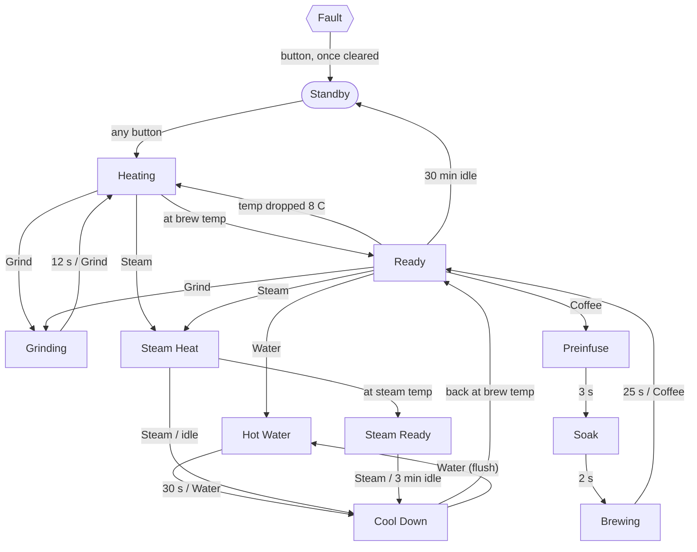

# PicoCoffeeZanussi

Replacement controller for a **Zanussi ZCOF637X** espresso machine, built on a Raspberry Pi **Pico 2 W**. The firmware is a single C++ file running a state machine. It handles heating, grinding, a three-stage brew (pre-infuse, soak, extract), hot water and steam, and it has safety cut-outs.

> [!WARNING]
> This project switches a mains-powered heater and pump. Build it only if you are competent with mains wiring. Use relays rated for the load, keep low-voltage and mains wiring separated, and keep the machine's original thermal fuses and thermostats in circuit. The firmware's safety checks are an extra layer, not a replacement for them.

## Features

- Brew sequence: pre-infuse, soak, extract, with a countdown on the display.
- Timed grinding for one dose.
- Hot water, and steam with its own higher temperature setting.
- Cool-down after steaming, so you can't brew with an overheated block.
- PID heater control with delta-sigma output through a solid-state relay, driven by a K-type thermocouple.
- Safety faults that turn everything off and stay off until reset: thermocouple failure, over-temperature, and heating that takes too long.
- Automatic standby when the machine is left idle.
- Status shown on a strip of 7 WS2812 (NeoPixel) LEDs, a 128x64 OLED, or both.
- A 16-LED NeoPixel ring in place of the original halogen lamp.
- Serial log of every button press, state change and fault.
- Home Assistant integration over MQTT, with remote start and standby.
- Sound through an I2S amplifier: a chime when the machine is ready, an alarm at a fault, and seasonal tunes such as Jingle Bells in December.
- Web page over Wi-Fi with live status, a 15-minute temperature graph, and the settings (PID gains, temperatures, times), which are kept in flash.

## Hardware

| Part | Notes |
|---|---|
| Raspberry Pi Pico 2 W (RP2350) | A Pico W (RP2040) also works if you set `PICO_BOARD` to `pico_w` in `CMakeLists.txt`. The web interface needs the W's Wi-Fi |
| MAX6675 module + K-type thermocouple | Mounted on the boiler/thermoblock |
| 16-LED WS2812B ring | Replaces the halogen lamp. First in the LED chain |
| 7 x WS2812B LEDs (NeoPixel strip or individual pixels) | Status display, chained after the ring. Optional if you fit the OLED |
| 1.3" SH1106 128x64 I2C OLED | Optional if you fit the LEDs. A 0.96" SSD1306 also works, see [Configuration](#configuration) |
| SSR-25 DA solid-state relay, on a heatsink | Heater. Must be a solid-state relay, see [Heater control](#heater-control) |
| Relay module, active-high | Grinder, group solenoid, pump. Must be rated for mains loads |
| Carrier PCB with 5 V rail + 5 V 5 A DC supply | Powers the Pico, relay coils and LEDs |
| 4 momentary push buttons | Grind, Coffee, Water, Steam |
| MAX98357A I2S amplifier board + 4-8 Ω speaker (optional) | Sound. Up to 3 W from the 5 V rail |
| Raspberry Pi Debug Probe (optional) | For flashing, debugging and the serial log |

## Wiring

All signals are 3.3 V. Physical pin numbers are for the Pico 2 W.

| Function | GPIO | Pin | Connects to |
|---|---|---|---|
| Heater SSR | GP2 | 4 | Darlington array input. The array output sinks the SSR's input −, and the SSR's input + goes to 5 V |
| Grinder relay | GP3 | 5 | Relay IN2 |
| Group solenoid relay | GP4 | 6 | Relay IN3 |
| Pump relay | GP5 | 7 | Relay IN4 |
| Spare relay 1 | GP6 | 9 | Spare relay IN (held off) |
| Spare relay 2 | GP7 | 10 | Spare relay IN (held off) |
| LED data | GP10 | 14 | Ring DIN, through a 330 Ω resistor. Ring DOUT goes to the first status LED's DIN |
| OLED SDA | GP8 | 11 | OLED SDA |
| OLED SCL | GP9 | 12 | OLED SCL |
| Thermocouple data | GP16 (SPI0 RX) | 21 | MAX6675 SO |
| Thermocouple chip select | GP17 | 22 | MAX6675 CS |
| Thermocouple clock | GP22 (SPI0 SCK) | 29 | MAX6675 SCK |
| Grind button | GP18 | 24 | Button to 3V3 |
| Coffee button | GP19 | 25 | Button to 3V3 |
| Water button | GP20 | 26 | Button to 3V3 |
| Steam button | GP21 | 27 | Button to 3V3 |
| Sound data | GP11 | 15 | MAX98357A DIN |
| Sound bit clock | GP12 | 16 | MAX98357A BCLK |
| Sound word clock | GP13 | 17 | MAX98357A LRC. Must be the pin after BCLK |
| Serial log TX | GP0 | 1 | Debug Probe UART RX |
| Serial log RX | GP1 | 2 | Debug Probe UART TX |

Power: the Pico sits on a carrier PCB with a 5 V rail, fed by a 5 V 5 A DC supply. The rail powers the Pico, the relay coils and the LEDs.

- **Pico:** 5 V rail to **VBUS (pin 40)**. The Pico's USB connector isn't used. For debugging, the board's VSYS (pin 39) connects to the debug board's VSYS, so the debug board can power the Pico when the supply is off. Both Picos have a diode from VBUS to VSYS, so with the supply and the debug board both connected, neither can back-feed the other's USB or the 5 V rail.
- **OLED and MAX6675:** VCC to **3V3(OUT), pin 36**, GND to any GND pin. Don't power the OLED from 5 V: its on-board pull-ups would put 5 V on GP8/GP9.
- **Relay module:** the coils run from the 5 V rail, not the Pico's 3.3 V regulator. Only the IN signals connect to the GPIOs.
- **Ring and status LEDs:** 5 V and GND from the rail, not through the Pico. They draw about 0.4 A at the default brightness and up to about 1.4 A at full white, well within the 5 A supply. A 100-1000 µF capacitor across the LEDs' 5 V and GND is good practice. Most WS2812Bs accept the Pico's 3.3 V data signal on a short wire. If yours flicker or show the wrong colours, add a 74AHCT125 level shifter.
- **MAX98357A:** VIN to the 5 V rail, GND to GND, and the speaker across its + and − outputs (neither side goes to ground). Leave SD and GAIN unconnected: the board then plays the average of left and right (the firmware sends the same sound to both) at 9 dB gain. Use the `Volume` setting to make it quieter.
- **Buttons:** each one connects its GPIO to 3V3. The firmware turns on the internal pull-downs, so you don't need resistors.

## Using the machine

| Button | Short press | Hold 2 s |
|---|---|---|
| **Grind** | Grind one dose (press again to stop early) | |
| **Coffee** | Press once for an espresso, twice quickly for a long coffee. Press again during the shot to stop it. Acts when you let go | Switch to standby from any state, without starting the pump |
| **Water** | Hot water through the wand (press again to stop) | |
| **Steam** | Heat for steam; press again to leave steam mode | |

Coffee acts when you let go of it, not when you press it, so that a 2 s hold for standby can't start a shot first. The other buttons act as soon as you press them.

A long coffee has the same pre-infuse and soak as an espresso, with a longer extract (45 s by default). The first press starts the shot straight away, and a second press within 0.6 s (`DOUBLE_PRESS_MS`) turns it into a long coffee. After that, pressing Coffee stops the shot as usual. The display shows **ESPRESSO** or **LONG COFFEE** during the shot.

Any button wakes the machine from standby. It heats to brew temperature and shows **READY** when it's there. For steam, wait for **STEAM RDY**, then open the steam knob. When you leave steam mode the machine shows **COOL DOWN** until it's back to brew temperature. Pressing Water during cool-down flushes water through the wand to speed this up.

The display shows the state, the current and target temperature, a countdown for timed steps, and a hint for what to press next.

### Relay test

Set `RELAY_TEST_MODE` to `true` at the top of `PicoCoffeeZanussi.cpp` to test the relays from the [web page](#web-interface). The state machine doesn't run, the buttons do nothing, and the heater stays off.

The page shows a **Relay test** card with an on/off button for the pump, group solenoid and grinder. For safety:

- Each relay switches itself off after 30 s (`RELAY_TEST_MAX_ON_MS`). Pressing its button again restarts the 30 s.
- All relays switch off within 3 s (`RELAY_TEST_PAGE_MS`) of the page going away: closing the tab, losing Wi-Fi, or the browser pausing a background tab.

The OLED shows each relay's state and time left. On the status LEDs, LED 1 is cyan for the pump, LED 2 is white for the solenoid, and LED 3 is yellow for the grinder. The other status LEDs glow dim magenta to show you're in test mode. The relay coils run from the 5 V rail, so the PSU must be on.

Before running the pump, fill the water tank and put a cup under the group head. With the solenoid closed the pump feeds the steam wand, so open the steam knob and hold a jug under it too.

Set `RELAY_TEST_MODE` to `false` and rebuild to use the machine normally.

### Status LEDs

The first six status LEDs form a bar: the colour shows the state, and on a progress bar the number of lit LEDs shows how far along it is, with the leading LED pulsing. The last LED is a power indicator.

| State | Colour | Pattern |
|---|---|---|
| Standby | | Off |
| Heating | Orange | Bar fills as the temperature rises from 20 °C to brew temperature |
| Ready | Green | All on |
| Grinding | Yellow | Bar empties as the grind time runs out |
| Pre-infuse, Soak, Brewing | White | Bar fills across the whole shot |
| Hot Water | Cyan | Bar empties as the run time runs out |
| Steam Heat | Blue | Bar fills as the temperature rises from brew to steam temperature |
| Steam Ready | Blue | All on |
| Cool Down | Magenta | Bar fills as the block cools back to brew temperature |
| Fault | Red | Flashing. 1 LED: thermocouple, 2 LEDs: over-temperature, 3 LEDs: heat timeout |

Bars fill from the status LED nearest the ring.

The power LED, the last on the strip, shows whether the machine is on and up to temperature:

| State | Power LED |
|---|---|
| Standby | Breathes red |
| Heating, Steam Heat | Red, through orange and yellow, to green as the temperature rises from cold to the target. For steam the whole range runs up to steam temperature, so at brew temperature it's yellow-green and turns fully green at steam temperature |
| Cool Down | Red to green as the block cools back to brew temperature |
| Ready, Grinding, brewing, Hot Water, Steam Ready | Green |
| Fault | Flashes red, in step with the fault flash on the bar |

The ring lights warm white whenever the machine is on, and goes off in standby.

At start-up all the LEDs run a test pattern until you press any button. That press only stops the test, it doesn't wake the machine. The test lights every LED red, green, blue, then white for 1 s each, which checks every colour channel. Then a single white LED walks from the first ring LED to the last status LED, which checks the wiring order and the LED count. The test runs at low brightness (`LED_TEST_BRIGHTNESS`), so it draws only about 90 mA and can run from the Pico's USB alone.

### Sound

With a MAX98357A amplifier fitted, the machine plays:

| When | Sound |
|---|---|
| **READY** or **STEAM RDY** after warming up | A rising chime |
| A fault | A two-tone alarm, three times |
| The first **READY** of the day in December | Jingle Bells instead of the chime |

The chime only plays after a real warm-up of 10 s or more (`CHIME_AFTER_MS`), so it doesn't sound after every grind. The seasonal tune needs the date, which the controller gets from network time (`pool.ntp.org`) once it's on Wi-Fi. Until then, and without Wi-Fi, it plays the chime.

Set the volume on the web page, from 0 (silent) to 100 %. The **Sound** card on the web page has a button for each tune, to try them out. It plays at the saved volume, so save a new volume before trying it.

Tunes are [RTTTL](https://en.wikipedia.org/wiki/Ring_Tone_Text_Transfer_Language) strings in the `TUNES` table, the ringtone format of old mobile phones, so many tunes are available ready to paste. To add a seasonal tune, add it to `TUNES`, then add a row to `SEASONAL_TUNES` with its month and first and last day. For example, `{10, 31, 31, "halloween"}` plays a tune called `halloween` on 31 October. The dates are UTC unless you set `UTC_OFFSET_MIN`.

The sound is made by the Pico itself: each note is a sine wave with a little of its second and third harmonics, and fades like a struck bell. PIO sends it to the amplifier over I2S, and DMA feeds the PIO, so playing a tune takes almost no processor time and the main loop's pauses don't affect it.

## State machine



These transitions are left out of the diagram:

- **Fault:** any state goes to Fault on a thermocouple failure (3 bad reads in a row) or at 165 °C. Heating and Steam Heat also go to Fault if they don't reach temperature within 5 minutes.
- **Standby:** holding Coffee for 2 s goes to Standby from any state except Fault.

### How the code is organised

The firmware is in [`PicoCoffeeZanussi.cpp`](PicoCoffeeZanussi.cpp), with the web page in [`web_page.h`](web_page.h):

- **`STATES` table:** one row per state. It sets the heater target, which relays are on, the state's timer and idle timeout, and the hint shown on the display. To change what a state does, edit its row.
- **`collect_events()`:** turns button presses, timers, temperature readings and fault conditions into events, with safety events first.
- **`next_state()`:** the transition table, and the only place where states change. The machine makes at most one transition per loop.
- **`LED_STYLES` table:** the colour and pattern for each state on the status LEDs.
- **`update_heater()`:** the PID controller. It sets the heater power toward the current state's target, and sets zero power whenever the temperature reading is invalid.
- **`heater_step()`:** the delta-sigma output, run from a timer interrupt once per mains cycle.
- **`DEFAULT_SETTINGS` and `SETTING_FIELDS`:** the settings that can be changed from the web page, with their defaults and allowed ranges. To add a setting, add it to the end of `Settings`, then to `DEFAULT_SETTINGS` and `SETTING_FIELDS`, and the web page shows it automatically. Settings saved before then keep their values, and the new one starts at its default.
- **`TUNES` and `SEASONAL_TUNES`:** the tunes, and which dates play which. `sound_on_state()` chooses the sound for each state change.
- **`http_handle()`:** the web server's routes.

## Heater control

The heater uses two layers of control:

1. **PID:** on every thermocouple reading (every 250 ms), `update_heater()` sets a heater power from 0 to 100% toward the current state's target. The D term works on the temperature, not the error, so changing target (brew to steam) doesn't make the power jump. The I term stops growing while the output is already at 0% or 100%.
2. **Delta-sigma:** once per mains cycle, a timer interrupt adds the power to an accumulator and switches the heater on for that cycle whenever the accumulator reaches a whole cycle. For 30% power, 3 cycles in every 10 are on, spread as evenly as possible. The interrupt runs on time even while the main loop is busy, and it switches the heater off if the main loop hasn't updated the power for 1 s.

> [!IMPORTANT]
> The heater must be on a solid-state relay. Delta-sigma switching would wear out a mechanical relay within days.

The SSR is switched from 5 V through a Darlington array (ULN2003 or similar), so the Pico's pin only drives the array's input. The array turns on when GP2 is high, so the firmware's active-high output works without change. The array drops about 1 V, which leaves the SSR about 4 V, within its 3-32 V input range.

### Tuning

The default gains are starting points. Tune them on the [web page](#web-interface), which shows the temperature graph and the P and I terms live, with the machine cold and filled with water. Changes take effect straight away. The serial log shows the same values every 2 s.

1. Set Ki and Kd to 0. Raise Kp until the temperature settles near the target without oscillating. It will settle a little below the target.
2. Raise Kd to cut the overshoot when heating from cold. Thermoblocks overshoot because the thermocouple lags the heater.
3. Raise Ki until the temperature settles on the target within a minute or two. Too much makes it oscillate slowly.

## Web interface

The Pico 2 W joins your Wi-Fi network and serves a web page with:

- **Status:** state, temperature, target, heater power, time left in a timed step, which outputs are on, and the PID terms. It updates every second.
- **Temperature graph:** the last 15 minutes of temperature, target and heater power. The controller keeps the history, so the graph is full as soon as you open the page.
- **Settings:** brew and steam temperatures, PID gains, and the grind, pre-infuse, soak, extract and hot-water times. **Save** applies them at once and stores them in flash, so they survive a power cut. **Restore defaults** goes back to the values in `DEFAULT_SETTINGS`.

The safety limits (`OVER_TEMP_C`, `HEAT_TIMEOUT_MS`) stay fixed in the firmware, and every setting is range-checked. For example, steam temperature can't go above 150 °C.

### Setting up

1. Copy [`wifi_config.example.h`](wifi_config.example.h) to `wifi_config.h` and fill in your network name and password. `wifi_config.h` is in `.gitignore`, so your password stays out of the repository.
2. Rebuild. The build only notices a newly created `wifi_config.h` when `PicoCoffeeZanussi.cpp` is recompiled, so save that file once, or clean the build.
3. Watch the serial log for the address:
   ```
   [  3.512] Wi-Fi: connected, http://192.168.1.42/ or http://zanussi.local/
   ```
4. Open either address in a browser on the same network.

Without `wifi_config.h` the firmware builds and runs as before, with the web interface left out. The firmware reconnects by itself if the network drops.

> [!WARNING]
> The page has no password, so anyone on your network can change the settings. Keep the machine on a home network you trust, never on a public or guest one, and don't expose it to the internet.

### API

The page uses a small JSON API, which you can also call yourself:

| Request | Returns |
|---|---|
| `GET /api/status` | Current state, temperature, target, power, PID terms, outputs, Wi-Fi signal and uptime |
| `GET /api/history` | The last 15 minutes, one point a second: `temp` (°C or `null`), `target` (°C or `null` when the heater is off) and `power` (%) |
| `GET /api/settings` | Current `values`, `defaults`, and the `fields` with their labels, units and limits |
| `POST /api/settings` | Changes settings. Form-encoded body, for example `brew_temp_c=93&kp=0.1`. Settings left out stay as they are, and nothing changes if any value is out of range |
| `POST /api/settings/reset` | Restores the defaults |
| `GET /api/sound` | The tune names, whether a tune is playing, and the date if it's known |
| `POST /api/sound` | Plays a tune, for example `tune=jingle_bells` |
| `POST /api/relay` | [Relay test mode](#relay-test) only: switches a relay, for example `relay=pump&on=1`. `relay` is `pump`, `valve` or `grinder` |

Times are in seconds in the API.

## Home Assistant

The machine can join Home Assistant through MQTT. It uses MQTT discovery, so it appears as a **Coffee Machine** device with no YAML to write.

### Setting up

1. Install an MQTT broker, for example the **Mosquitto broker** add-on, and the **MQTT** integration in Home Assistant.
2. Add the broker to `wifi_config.h`, using the broker's IP address. `.local` names don't resolve on the Pico:
   ```c
   #define MQTT_HOST     "192.168.1.10"
   #define MQTT_BROKER_PORT 1883         // optional, 1883 is the default
   #define MQTT_USER     "mqtt-user"     // leave out if the broker needs no login
   #define MQTT_PASSWORD "mqtt-password"
   ```
3. Save `PicoCoffeeZanussi.cpp` so it's recompiled, then build and flash.
4. The serial log shows `MQTT: connected to ...`. The device then appears under **Settings → Devices & services → MQTT**.

Leave `MQTT_HOST` out to build without MQTT.

### What appears in Home Assistant

| Entity | Type | Notes |
|---|---|---|
| Power | Switch | On starts heating from standby. Off goes to standby |
| State | Sensor | `STANDBY`, `HEATING`, `READY`, `BREWING` and so on |
| Temperature, Target temperature | Sensors | °C |
| Heater power | Sensor | % |
| Time left | Sensor | Seconds left in a timed step |
| Fault | Sensor | `none`, `THERMOCOUPLE`, `OVER TEMPERATURE` or `HEAT TIMEOUT` |
| Wi-Fi signal | Sensor (diagnostic) | dBm |
| Pump, Group solenoid, Grinder, Heating | Binary sensors | |
| Every [setting](#configuration) | Numbers (configuration) | Same limits as the web page. Changes are saved to flash |

The machine also publishes "offline" through the broker if it loses power or Wi-Fi, so its entities show as unavailable.

### Remote start rules

- **Remote start** only wakes the machine from standby. It heats to brew temperature, exactly as if you'd pressed a button.
- **A fault can't be cleared remotely.** If the machine is in Fault, remote start is refused and logged. You have to press a button on the machine once the fault has cleared.
- **Remote standby** works from any state except Fault, the same as holding Coffee for 2 s.
- **Unchanged safety:** the heat timeout, the 30-minute idle standby and the over-temperature cut-out all still apply. A remote start counts as activity, so the machine goes back to standby 30 minutes later unless you use it.
- **Relay test mode** ignores remote commands.

For example, this automation heats the machine every weekday morning:

```yaml
automation:
  - alias: "Warm up the coffee machine"
    triggers:
      - trigger: time
        at: "06:45:00"
    conditions:
      - condition: time
        weekday: [mon, tue, wed, thu, fri]
    actions:
      - action: switch.turn_on
        target:
          entity_id: switch.coffee_machine_power
```

### Topics

| Topic | Direction | Payload |
|---|---|---|
| `zanussi/state` | Published, retained | JSON: `state`, `temp`, `target`, `power`, `time_left`, `fault`, `pump`, `valve`, `grinder`, `heating`, `on`, `rssi`. Sent on change (at most once a second) and every 30 s |
| `zanussi/settings` | Published, retained | JSON with every setting, in the web page's units |
| `zanussi/availability` | Published, retained | `online` or `offline` |
| `zanussi/power/set` | Subscribed | `ON` or `OFF` |
| `zanussi/settings/<key>/set` | Subscribed | A number, for example `zanussi/settings/brew_temp_c/set` with `93` |
| `homeassistant/<type>/zanussi/<id>/config` | Published, retained | Discovery messages. Sent again whenever Home Assistant restarts |

> [!WARNING]
> Anyone who can publish to your broker can start the machine. Give the broker a username and password, and don't expose it to the internet.

## Building and flashing

This project uses the [Raspberry Pi Pico VS Code extension](https://marketplace.visualstudio.com/items?itemName=raspberry-pi.raspberry-pi-pico) with Pico SDK 2.3.1.

1. Open the folder in VS Code. The extension installs the SDK and toolchain.
2. Click **Compile** in the status bar, or run `ninja` in `build/`.
3. Flash by one of these methods:
   - **Debug Probe:** use **Run → Start Debugging**, or the extension's **Run** button.
   - **USB:** with the 5 V supply off, hold BOOTSEL while plugging in the Pico, then copy `build/PicoCoffeeZanussi.uf2` to the drive that appears.

## Serial log

Logging goes to both UART0 (GP0/GP1, 115200 baud) and USB. With a Debug Probe, open its COM port. With the Pico plugged into USB, open the Pico's own COM port.

```
=== Zanussi ZCOF637X controller ===
[  1.002] I2C device found at 0x3C
[  1.004] OLED at 0x3C OK
[  1.004] State: STANDBY
[  4.512] Button COFFEE pressed
[  4.512] STANDBY -> HEATING (COFFEE pressed, 21.50 C)
[  5.004] HEATING    temp=22.25 C set=95 power=100% (P=5.82 I=0.00 rate=0.00 C/s) pump=0 valve=0 grinder=0 oled=1
```

## Configuration

The temperatures, PID gains, step times and volume are settings: change them on the [web page](#web-interface), or change their defaults in `DEFAULT_SETTINGS`.

| Setting | Default | Allowed |
|---|---|---|
| Brew temperature | 97 °C | 85-100 °C |
| Steam temperature | 120 °C | 110-150 °C |
| Kp / Ki / Kd | 0.04 / 0.0004 / 0.4 | 0-1 / 0-0.05 / 0-5, see [Heater control](#heater-control) |
| Grind | 6.5 s | 1-60 s |
| Pre-infuse / Soak / Extract | 3 s / 2 s / 25 s | 1-10 s / 1-20 s / 5-60 s |
| Extract, long coffee | 45 s | 10-120 s |
| Hot water | 30 s | 5-120 s |
| Volume | 30 % | 0-100 % |

Everything else is a constant at the top of `PicoCoffeeZanussi.cpp`.

| Constant | Default | Purpose |
|---|---|---|
| `RELAY_TEST_MODE` | `false` | Relay test from the web page instead of normal operation, see [Relay test](#relay-test) |
| `OVER_TEMP_C` | 165 °C | Safety cut-out |
| `HEATER_STEP_MS` | 20 ms | One mains cycle: 20 for 50 Hz, 17 for 60 Hz |
| `HEAT_TIMEOUT_MS` | 5 min | Fault if not at temperature by then |
| `DOUBLE_PRESS_MS` | 0.6 s | A second Coffee press this soon after the first makes a long coffee |
| `IDLE_MS` / `STEAM_IDLE_MS` | 30 min / 3 min | Auto standby / leave steam mode |
| `RING_COUNT` | 16 | Number of LEDs in the lamp ring |
| `RING_R` / `RING_G` / `RING_B` | 255 / 160 / 60 | Lamp colour (warm white) |
| `RING_BRIGHTNESS` | 128 | Lamp brightness, 0-255 |
| `LED_COUNT` | 7 | Number of status LEDs |
| `LED_BRIGHTNESS` | 64 | Status LED brightness, 0-255 |
| `LED_TEST_BRIGHTNESS` | 16 | Brightness of the start-up LED test, 0-255 |
| `OLED_COLUMN_OFFSET` | 2 | 2 for an SH1106 (1.3"), 0 for an SSD1306 (0.96") |
| `OLED_ADDRESS` | `0x3C` | Some modules use `0x3D` |
| `CHIME_AFTER_MS` | 10 s | Chime at READY only after warming up for at least this long |
| `UTC_OFFSET_MIN` | 0 | Your time zone in minutes, for the seasonal tunes' dates: 60 for CET, -300 for EST |

The times and temperatures are starting points. Tune them for your grind and beans.

The firmware assumes the group solenoid opens the path to the group head only while brewing, and that the steam/water knob on the wand is opened by hand. If your machine is plumbed differently, change the `valve` column in the `STATES` table.

## Troubleshooting

| Symptom | Likely cause |
|---|---|
| No serial output on the Debug Probe | The Probe's **U** (UART) port isn't wired to GP0/GP1, or the D and U cables are swapped |
| OpenOCD: `cannot read IDR` | The Pico isn't powered, or the SWD wiring is wrong (Probe **D** port to the Pico's DEBUG header) |
| Pico regulator gets hot | A short on 3V3, such as a solder bridge, reversed OLED VCC/GND, or relay coils powered from 3V3 |
| OLED shows random dots with garbled text at the top | SH1106 display with `OLED_COLUMN_OFFSET` or the driver set up for SSD1306 |
| `I2C scan: no devices` | Check SDA/SCL wiring and the OLED's power |
| `FAULT: THERMOCOUPLE` | Thermocouple open circuit, or the MAX6675 isn't wired or powered |
| `FAULT: HEAT TIMEOUT` | Heater relay or heater not working, or the thermocouple isn't attached to the block |
| `Web interface off: no wifi_config.h` | Create `wifi_config.h`, then save `PicoCoffeeZanussi.cpp` so it's recompiled |
| `Wi-Fi: wrong password` / `network ... not found` | Check `wifi_config.h`. The Pico 2 W only uses 2.4 GHz networks |
| `MQTT: connection to ... failed (5)` | Wrong `MQTT_USER` or `MQTT_PASSWORD` |
| `MQTT: can't find broker` or no `MQTT: connected` | Check `MQTT_HOST` is the broker's IP address and the broker is running |
| No sound | Check the `Sound (I2S)` line in the serial log, the `Volume` setting, and the MAX98357A's 5 V. BCLK and LRC swapped gives silence |
| `zanussi.local` doesn't open | Some networks and older Android phones don't support mDNS names. Use the IP address from the serial log |

## License

[MIT](LICENSE)
